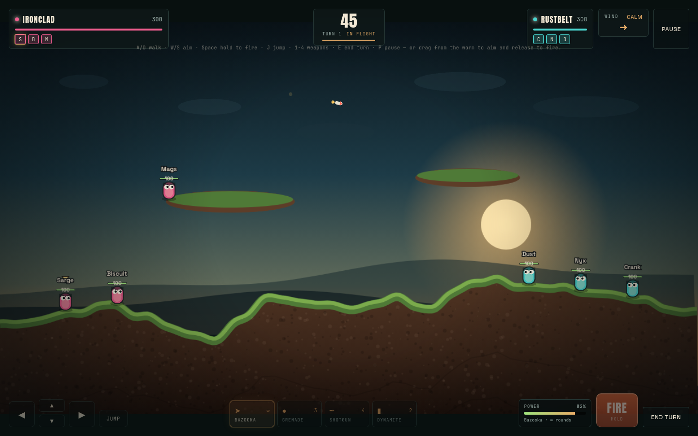

# Wormage

A turn-based artillery duel in the browser: two teams of three worms, one destructible island, wind that ruins your best shot. The first playable version of Wormage, built on a production-grade front-end stack — **React + strict TypeScript + PixiJS + TanStack Query + Axios + MSW + Playwright**.

> **Demo build.** This is the first playable version of Wormage. Campaign, progression and online play are on the [roadmap](docs/ROADMAP.md).

**Live demo:** [wormage.flabs.tech](https://wormage.flabs.tech).



## Why an artillery game

Artillery is a small ruleset with unusually demanding engineering underneath: destructible pixel terrain, ballistics bent by wind, a turn state machine, and an opponent that has to solve the same equations the player does. Around that loop sits a real product surface: typed configuration, a mocked REST backend with pagination, idempotent match writes, persistent settings and a documented test suite.

The genre also forces the separation this project is built around: the simulation cannot depend on the renderer, the frame rate or React.

## One developer, one demo, a bigger game

Wormage is built in the open by one developer — [Fabio Borges](https://flabs.tech), a full-stack and AI engineer from Joinville, Brazil. The live build is the first version: a complete artillery skirmish that proves the core. The real game adds a campaign, progression, online matches and a server that owns the result.

The [full story](docs/ABOUT.md) explains what exists today, what comes next and why the project is built in public. The [roadmap](docs/ROADMAP.md) tracks the milestones.

## Stack

| Responsibility | Technology |
| --- | --- |
| Menus, HUD, dialogs | React 18 |
| Language | TypeScript, `strict: true` |
| Arena, worms, effects | PixiJS 8 |
| Ranking / history state | TanStack Query 5 |
| HTTP client | Axios |
| Network mocks | MSW 2 |
| E2E | Playwright |
| Build | Vite 6 |

No game engine, no physics library, no third-party art. Terrain, worms, explosions and sound are generated at runtime.

## Quick start

```bash
npm install
npm run dev            # http://localhost:5173
npm run typecheck      # strict TS, no emit
npm test               # Vitest unit tests, no browser
npm run build          # production bundle in dist/
npm run build:single   # one self-contained HTML file in dist-single/
npm run test:e2e       # Playwright (uses installed Chrome)
```

`npm run dev` boots the MSW service worker, so the ranking and history tabs work offline. In the single-file build the same REST surface is served by an in-process Axios adapter, because sandboxed iframes cannot register service workers.

`/` redirects to `/demo`, where a New Game dialog starts the match; `/project` is this informational page. The single-file build has no real routes — open it at `/`, it starts on the demo screen, and the dialog hides the project link.

## How to play

| Action | Keyboard | Touch |
| --- | --- | --- |
| Walk | `A` / `D` or arrows | ◀ ▶ pads |
| Aim | `W` / `S` | ▲ ▼ pads, or tap/drag the field |
| Fire | `Space` (hold to charge) | hold **Fire**, or drag 8 px+ and release |
| Jump | `J` | Jump |
| Switch weapon | `1`–`4` | weapon dock |
| End turn | `E` | End turn |
| Pause | `P` / `Esc` | Pause |

Three worms per side, 100 HP each. Wipe out the other team to win. The turn timer ends your turn, not the match. Falling into water is fatal; long falls hurt. Self-damage is on, as tradition demands.

Weapons: **Bazooka** (unlimited, 42 dmg), **Grenade** (3 bounces, 3s fuse), **Shotgun** (4 flat shots), **Dynamite** (2, 2.2s fuse, huge crater). After firing you have three seconds to walk before the turn passes — enough to leave your own blast.

## Architecture at a glance

```
src/
  game/        pure simulation + Pixi renderer, no React imports
    config.ts  every balance number lives here
    engine.ts  turn state machine, physics, damage, win conditions
    terrain.ts bitmask collision + destructible canvas
    ai.ts      ballistic solver used by both the CPU and the aim preview
    renderer.ts Pixi scene graph, particles, camera shake
    audio.ts   WebAudio synth (no asset files)
  ui/          React screens and HUD
  api/         Axios client, TanStack hooks, mock server + types
  mocks/       MSW worker and handlers
  state/       localStorage persistence (settings, identity, last result)
```

The authoritative state is `GameEngine`. React receives a **throttled snapshot at ~10 Hz**; the renderer reads engine state every frame. UI buttons call engine methods through refs, never the other way around.

Full detail: [docs/ARCHITECTURE.md](docs/ARCHITECTURE.md). Balance knobs: [docs/CONFIGURATION.md](docs/CONFIGURATION.md). Code-level trade-offs: [docs/DECISIONS.md](docs/DECISIONS.md). Roadmap, architecture decisions and contribution rules: [docs/ROADMAP.md](docs/ROADMAP.md), [docs/adr/](docs/adr/README.md), [CONTRIBUTING.md](CONTRIBUTING.md).

## Ranking and match history

- `GET /api/leaderboard?configKey=&page=&pageSize=` — best score per player for the active ruleset, deterministic tie-break (score desc, duration asc, date asc).
- `GET /api/matches?playerId=&page=&pageSize=` — the player's own service record.
- `POST /api/matches` — idempotent on `clientMatchId`; retries return the existing record instead of duplicating it.

All three are implemented once in `src/api/mockServer.ts` and exposed twice: through MSW at the network layer, and through an Axios adapter when a service worker is unavailable. Both paths share the same fixtures, validation and storage, so the demo and the tests agree.

Options include a **Demo network** switch (normal / slow / empty / error) to exercise loading, empty and failure states without editing code.

## Testing

Playwright drives the real UI against the dev server and asserts authoritative state through a documented instrumentation hook (`window.__WORMAGE__.snapshot()`), so tests do not scrape pixels for logic. The suite runs on desktop and mobile viewports. Visual baselines are not written yet; they are planned for M1.

```bash
npm run test:e2e
npx playwright show-report
```

See [tests/README.md](tests/README.md).

## Deploy

The live build is [wormage.flabs.tech](https://wormage.flabs.tech). Vercel auto-deploys `main`; `vercel.json` keeps the SPA rewrite and serves `/mockServiceWorker.js` from the root with the headers MSW needs. Merging to `main` is the deploy.

## Credits

All artwork is drawn procedurally with PixiJS graphics and canvas gradients; all sound is synthesized at runtime. No Worms Armageddon assets are used — the project is a genre homage, not a reproduction of Team17's art.

## License

MIT — see [LICENSE](LICENSE).
